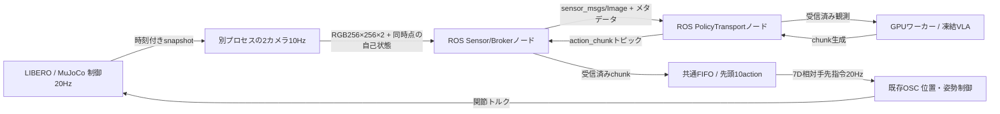

# リアルタイムを想定するVLA action chunk実行

2026-11-02。最終提出は、SmolVLAとπ0.5によるLIBERO操作タスクの同期・非同期比較を対象とする。小型モデルの低遅延が実時間操作に有利かを検証し、モデル名やパラメータ数から精度・速度の優劣を決めない。初期のSmolVLA・π0-FAST比較は別の実験履歴として保持する。

## 再利用する資産

同じLIBEROのタスク・カメラ・Panda・制御器を使い、LIBERO向け学習済みSmolVLAとπ0.5の公開重みを追加学習なしで実行する。公式LeRobotライブラリで前処理・正規化・行動生成と出力処理を行う。モデルと実装のrevisionを固定し、同じ初期状態で比較する。SmolVLAの資産は[主な公開資産](../reference/realtime-vla-assets.md)、π0.5の資産・復元・利用条件は[π0.5資産一覧](../reference/pi05-libero-assets.md)に記録する。

## 同期実行と非同期実行

同期実行（lockstep）は推論やROSを待つ間、シミュレーション時間を止める。非同期実行（realtime）はシミュレータの制御ループと推論を分離し、chunk生成中も周期的な制御と物理更新を継続する。実経過時間に基づく制御周期を基準とし、物理計算自体の遅れも記録する。

主比較は両モデルとも50行動をflow反復10回で生成し、先頭10行動を実行する。行動列を使い切ってから次の推論を要求し、先読みは行わない（E10/P0）。配置1〜5を同期・非同期で実行し、2モデル×2方式×5配置の20試行を比較する。同期は最大280制御ステップ、非同期は最大14実秒または280制御ステップであり、同じ実経過時間制限ではない。

## 比較する量

- タスク成功・到達時間・物体と目標の終端誤差。
- chunk生成時間（平均・p95・最大）、観測取得から実行までのage。
- action queue残量・枯渇、待機action比率、expired action数。
- 実際の制御周期・期限超過・シミュレーション時間と実経過時間の比。
- 同じモデルのlockstep基準との性能低下。
- GPUメモリ。モデルは1種類ずつ実行し、同時推論による競合を避ける。

制御指令の変化量は滑らかさの指標であり、位置精度そのものとは呼ばない。モデルが出す差分目標と関節追従誤差、タスクの物体目標誤差は区別する。chunkが長いだけで観測が新鮮になるとは扱わない。

## queueが空のとき

相対姿勢指令を繰り返すと、停止ではなく移動を継続してしまう。空queue時は位置・姿勢の差分をゼロにして、グリッパ状態の指令のみ保持する。学習モデルのactionを勝手に「最後の値保持」で再実行しない。これもtaskを成功させる補助policyではなく、入力が届かない間の待機規則として全モデルへ同じ条件で適用する。

## 公平性

最終提出の主比較では、SmolVLAとπ0.5の生成長H50、flow反復10回、E10/P0、FIFO、制御設定20Hz、ROS通信をそろえる。一方、モデル構造、内部画像解像度、数値精度の設定、学習条件は異なる。共通の設定で実行した結果を比較し、モデル規模や公表ベンチマークを今回のタスク成績の代用にしない。

RTCは同じ基盤モデル内で、補正なし・公開LeRobot RTC・完全VJP RTCを比較する。50行動を保持して残り30行動で要求し、受信時に経過部分を除くH50/R30の別条件である。主比較から実行長・先読み・時刻整列が変わるため、E10/P0との差をRTCだけの効果とは扱わない。π0-FASTの自己回帰生成を使った旧比較は[従来の実験記録](../experiments/realtime-vla.md)に分離する。

## 実装の境界

モデル生成長、実際に実行するaction数、次の推論を要求する残量、遅れて届いたchunkの採否を設定として保存する。固定した初期状態と乱数を用い、追加学習せず比較する。実時間周期に追従できない場合は、リアルタイム達成とは報告せず、その不足も評価結果へ含める。

## 実際に構築した構成

実装は `experiments/realtime_vla/`。ROS Jazzy/CycloneDDSを別コンテナに置き、ホストのGPUライブラリとはTCP adapterで接続する。画像・自己状態・生成actionは実際にROSトピックを往復し、受信した値をモデル入力および制御に使用する。metadataだけをROSに送り、モデルは別の元画像を使う構成ではない。送受信のハッシュを各chunkに保存する。

Sensor/BrokerとPolicyTransportは別ROSプロセス。物理、カメラ、モデルも別プロセスに分離する。GPUワーカー内でROSを待っても、物理の周期ループは待たない。queueは一度に1推論、カメラは最新snapshotのみ採用。制御途中の `wait()` はlockstep参照だけで許し、実時間ループでは `poll()` / `put_nowait()` を使う。

### カメラが周期を壊さないようにする

同期2カメラはWSLのNVIDIA描画経路を選んでも20Hz制御予算50msを超えた。物理は画像なしで進め、複製した同一シーンへ時刻付き物理状態を適用して別プロセスで描画する。元の同期環境とsnapshotを一致させ、画像・手先・グリッパを全バイト比較して一致を確認した。画像と自己状態は同じsnapshotから作る。描画終了時刻を取得時刻へ書き換えない。reset境界はepisode_idで古いフレームを除外する。

この一致検証は、同じsnapshotを両sceneで `regenerate_obs_from_state()` した場合の一致。通常の同期 `env.step()` が返す観測cacheとの一致ではない。正式試行の初期監査では、同じ方式のモデル間はセンサhashが一致し、方式間は物体位置とactuator ctrlが一致する一方でセンサhashは異なる。robosuiteの周期サンプリングcacheと、snapshot復元後の強制観測更新の位相差があるためで、lockstep対realtimeを純粋な推論遅延だけの比較として解釈しない。

### 凍結・実時間・成否を別に確認する

公開重みを厳密に復元し、実行前後の重みdigestが同じことを監査する。追加学習、optimizer、物体真値を入力する補正policyはない。controllerは学習時と同じrobosuite OSCであり、今回独自のIKを追加したとは扱わない。公式成功判定・物体の目標XY誤差は評価器だけで計算する。

主比較のE10/P0では、初期化・2回のwarmup・最初のchunk生成を初期物理状態を保持して計時外で実施する。warmup後に観測を取り直し、その取得時刻から初回actionまでのageは保持する。起動時間を実時間達成へ含めたとは報告しない。queueが空なら差分姿勢ゼロ＋グリッパ指令維持。FIFOは遅延actionの時刻を現在へ書き換えずに実行し、ageを計測する。この単純な待機方式はモデルへ遅延を条件づけるRTCとは異なる。

## 事前条件・結果・提出資料

主比較のSmolVLAは[初期の事前条件](../../artifacts/realtime-vla/formal-protocol.json)、追加したπ0.5は[π0.5の事前条件](../../artifacts/realtime-vla/pi05-protocol.json)を用いる。最終提出の対象となる20試行の値・集計定義・出典SHAは[主比較の監査JSON](../../artifacts/realtime-vla/submission-smol-pi05/evidence-primary.json)にまとめた。

[新提出PDF](../../artifacts/realtime-vla/submission-smol-pi05/説明資料_PAI最終課題_44055.pdf)はSmolVLA・π0.5の主比較、推論時間の分解、RTC等の追加検証を扱う。推論時間は[固定観測による実験記録](../experiments/realtime-inference-profiling.md)、接続方法は[追加実験の記録](../experiments/realtime-continuity.md)と[監査JSON](../../artifacts/realtime-vla/submission-smol-pi05/evidence-continuity.json)に分けて保存する。
