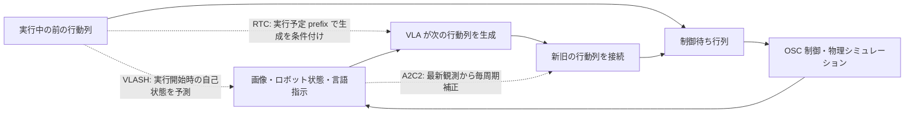

# 実時間 VLA の行動列を接続する手法: RTC・VLASH・A2C2

調査日: 2026-11-02。対象は LIBERO の Panda アーム、SmolVLA と π0.5 の公開済みモデル。以下は資産調査・実装判断の記録であり、各段階の未実施という記述はその時点の状態を示す。実測の最終結果は [追加実験記録](../experiments/realtime-continuity.md) を参照。既存の 35 試行と追加評価は分けて扱う。

## 調査時に決めた実行順

1. **最初は frozen SmolVLA + guided RTC**。通常の flow matching モデルに推論時の接続処理を追加する方法であり、追加学習を要しない。現在の LeRobot に SmolVLA / π0.5 用 API がある。ただし勾配モード、行動の正規化、行動列の時刻を合わせる必要がある。
2. **VLASH は公開済みの専用 π0.5 重みを使う候補がある**。通常の π0.5 に未来状態を入力するだけでは論文の再現にならない。公開重みと公式 `sim/libero` ブランチの組合せを先に検証し、その後、実際の推論遅延を含む非同期系に接続する。重みの利用条件はコードの Apache-2.0 と別に確認する。
3. **A2C2 にも著者が公開した補正モデルがある**。基盤 VLA の再学習は不要だが、手法そのものは学習済みの補正モデルを必要とする。公開された補正モデルと、それが対象にした基盤モデル・特徴抽出・正規化の対応を確認してから実行する。

## 何を補う手法なのか



| 手法 | 主に解く問題 | 学習に関する条件 | 今回の frozen モデルに対する扱い | 公開コードのライセンス |
| --- | --- | --- | --- | --- |
| guided RTC | 推論中に実行される前の行動列と、新しい行動列の不連続 | 通常の flow / diffusion policy に推論時の guidance。再学習不要 | SmolVLA と π0.5 は LeRobot 対応。π0-FAST の自己回帰トークン生成にはそのまま適用しない | 著者 Kinetix 実装 MIT、LeRobot 実装 Apache-2.0 |
| trained RTC | 同じ接続を推論時の追加微分なしで実現 | delay prefix を条件とする専用学習済みモデルが必要 | `rtc_training_max_delay=0` の通常 π0.5 には使わない | LeRobot Apache-2.0 |
| VLASH | 画像取得時と、行動が実行される時の自己状態のずれ | 画像を固定し、自己状態と正解行動を一緒に未来へずらした fine-tuning が必要 | 専用 π0.5-LIBERO 重みあり。通常 SmolVLA の入力置換だけを VLASH と呼ばない | Apache-2.0 |
| A2C2 | 長い行動列の途中で得られる新しい観測を使えない問題 | 基盤 VLA は固定。小さい補正 head は教師あり学習済みであることが必要 | 著者の LIBERO-Spatial 用補正重みあり。基盤モデルとの対応確認が必要 | Apache-2.0、継承元の MIT notice も保持 |

根拠: [RTC 論文](https://arxiv.org/abs/2506.07339)、[著者 RTC 実装](https://github.com/Physical-Intelligence/real-time-chunking-kinetix)、[LeRobot RTC ドキュメント](https://github.com/huggingface/lerobot/blob/main/docs/source/rtc.mdx)、[VLASH 論文](https://arxiv.org/abs/2512.01031)、[VLASH コード](https://github.com/mit-han-lab/vlash)、[A2C2 論文](https://arxiv.org/abs/2509.23224)、[A2C2 コード](https://github.com/k1000dai/a2c2-libero)。A2C2 は **Asynchronous Action Chunk Correction** であり、強化学習の A2C や別論文の AC2-VLA を指さない。

## 現在の観測と、最初に切り分けること

既存の 35 試行では、共通の実行長 E10・先読みなしで、SmolVLA の同期実行は 5/5、実時間実行は 3/5、π0-FAST は 4/5 と 1/5 だった。E10 のまま残り 5 行動で次の推論を始める変更では両者とも 0/5。SmolVLA で生成された 50 行動を実行する条件は 3/5 だったが、成功した初期状態の組合せは異なる。これは今回の測定値であり、上記論文の結果ではない。詳細は [既存実験記録](../experiments/realtime-vla.md) を参照。

ここでは次の量を区別する。

| 記号・量 | 定義 | 実装上の注意 |
| --- | --- | --- |
| H | 1 回に生成する行動列の長さ | SmolVLA と今回候補の π0.5 は 50。以前の π0-FAST は 10 |
| E | 次の更新までに採用する行動数 | H と別。生成結果を最初に E 個へ切ると、その先を RTC の prefix に使えない |
| d | 推論・通信中に実際に進んだ制御ステップ数 | ミリ秒ではなくステップ数。推定値と実測値を両方記録する |
| R | 推論を開始した時点の未実行行動数 | 空白を避けるには、推論中の実行を覆うだけの R が必要 |
| s | RTC の prefix attention が効く範囲の終端 | LeRobot の `execution_horizon`。全実装で E と同じ意味だと仮定しない |
| 観測から実行までの時間 | 入力画像の取得から、その結果の指令を実行するまで | モデル単体の推論時間だけで代用しない |

20 Hz で残り 5 行動は 250 ms 分に過ぎない。既存実測では生成と ROS 通信の平均は SmolVLA 約 604 ms、π0-FAST 約 1,018 ms なので、平均値の時点でこの先読み量を超えている。待機の解消と行動の接続は別の問題である。初期の条件探索は H50 を保持し、遅延の p95 と制御側で実際に消費した数から R を決める。現在の値だけで RTC / VLASH / A2C2 の成否は判断しない。

## 1. guided RTC: 追加学習なしで着手する経路

### 原理と LeRobot API

推論が終わるまでに既に実行される行動を変更できない prefix として扱い、前の行動列と整合するように、残りの行動を flow の生成過程で補完する。著者実装は denoiser の出力に対する vector-Jacobian product を使う。単なる新旧行動の平均ではない。[著者モデル実装](https://github.com/Physical-Intelligence/real-time-chunking-kinetix/blob/main/src/model.py)

今回確認した LeRobot は 0.6.2、commit `3f797de5952432284a7c77ad2760218cb74e2f26`。`RTCConfig(enabled=True, mode="guided", ...)` を設定し、`policy.predict_action_chunk(...)` へ以下を渡す。

| 引数 | 渡す値 |
| --- | --- |
| `prev_chunk_left_over` | 前の行動列の未実行部分。バッチ付き、モデルが使う正規化空間。制御器に渡した非正規化 7 次元値をそのまま渡さない |
| `inference_delay` | 次の生成が完了するまでに実行されると予測した行動数 |
| `execution_horizon` | 接続のための prefix attention 範囲。H、残り prefix 長、予測遅延と整合させる |

SmolVLA / π0.5 の `predict_action_chunk` と共通の `euler_integrate` にこの経路がある。SmolVLA は内部の padded action 次元と実際の 7 次元出力を区別する。LeRobot の action queue はモデル空間の `original_queue` と、実行用の `queue` を分け、推論中に消費された部分を除いて更新する。今回は正規化後の行動列と postprocess 後の行動列を対で保存し、同じ原点の時刻を付ける。[LeRobot queue 実装](https://github.com/huggingface/lerobot/blob/3f797de5952432284a7c77ad2760218cb74e2f26/src/lerobot/policies/rtc/action_queue.py)

### 勾配を使っても、モデルの再学習ではない

RTC の guidance は生成中の行動変数に対する入力微分を必要とする。重みは `requires_grad=False`、optimizer なしで固定できる。ただし外側の `torch.inference_mode()` の中では内部の `torch.enable_grad()` が機能せず、今回の CPU 検証でも `autograd.grad` が失敗した。`torch.no_grad()` は内部で必要な範囲だけ解除できる。現在の `FrozenSmolVLA.predict` の推論モードを RTC 用経路で調整し、出力を detach してから待ち行列へ渡す必要がある。

### 現在の LeRobot 実装で確認した微分の差

固定した上記 commit の `RTCProcessor.denoise_step` は `v_t = denoiser(x_t)` の**後**に `x_t.requires_grad_(True)` を設定する。この順序では denoiser の入力微分を遡れず、`x_t - time * v_t` の恒等写像側の項だけが残る。[対象ソース](https://github.com/huggingface/lerobot/blob/3f797de5952432284a7c77ad2760218cb74e2f26/src/lerobot/policies/rtc/modeling_rtc.py)

CPU の解析可能な例で、`denoiser(x)=2x`、`time=0.5`、`x=1`、前の行動値も 1 とすると、復元値 `x - 0.5*2x` の正しい入力微分は 0 になる。一方、stock 実装に渡された denoiser 入力は `requires_grad=False` であり、guided velocity は `[0, 1, 2, 2]`、完全な VJP なら `[2, 2, 2, 2]` だった。これはモデル・GPU を使わない実装検証であり、LIBERO の成功率比較ではない。

著者の JAX 実装では `jax.vjp(denoiser, x_t, has_aux=True)` が復元値と velocity の計算全体を微分する。LeRobot の処理は velocity を固定した一次の近似とも読めるが、その意図までは一次資料から確認できていないため、ここではバグと断定しない。評価では「そのままの LeRobot RTC」と「著者の VJP に合わせて入力の微分を有効化した RTC」を区別し、採用したコードと追加時間・GPU メモリを記録する。修正する場合もモデル重みは変更しない。完全な VJP による追加計算が遅延を増やす可能性があるため、接続の改善と総合のタスク成功を別々に測る。

### trained RTC の条件

LeRobot の `mode="trained"` は、対応する π0.5 checkpoint に `rtc_training_max_delay > 0` が必要。通常の checkpoint の設定を推論時に書き換えるだけでは対応モデルにならない。`prediction_steps > max_delay`、`execution_horizon >= max_delay`、`execution_horizon <= prediction_steps - max_delay` という実装上の制約もある。今回の通常 π0.5 は guided を使い、trained は専用重みを確認できた場合だけ別条件とする。[LeRobot RTC 設定](https://github.com/huggingface/lerobot/blob/3f797de5952432284a7c77ad2760218cb74e2f26/src/lerobot/policies/rtc/configuration_rtc.py)

## 2. VLASH: 専用重みを使う経路

### 論文が必要とするもの

VLASH は古い画像 `o_t` と、前の行動列を実行した後の自己状態 `s_(t+d)` を組み合わせる。自己状態はロボットの関節・手先・グリッパの状態であり、物体位置の正解や未来画像ではない。論文 IV-B は、通常モデルに未来状態を与えるだけでは不十分と述べ、画像を固定して自己状態と教師行動を同じ offset だけずらす fine-tuning を行う。追加学習しない今回の実験では、この学習が済んだ公開モデルを使う。[VLASH 論文 IV-A / IV-B](https://arxiv.org/html/2512.01031v2#S4)

### 公開された資産

| 項目 | 確認内容 |
| --- | --- |
| 公式 LIBERO コード | `mit-han-lab/vlash` の `sim/libero` ブランチ、確認時 commit `d2da223e2251a4a5020b667e77cf8ad57e594144` |
| 学習済みモデル | `mit-han-lab/vlash-pi05-libero-async5`、revision `c85d5962a7b823f9f391f97d60227d6ca8bd7bc7` |
| 重み | 7,472,953,952 bytes。SHA-256 `8dd3bf4766dac481933ced7c8de5fbfc31c486e665cca33e6ddf970792a46a2e`。HF が数えた保存要素 3,616,757,594（F32 + BF16） |
| 入出力 | H50、7 次元行動、2×256 RGB、自己状態 8 次元、MEAN_STD、flow 10 steps |
| 状態入力 | 公開 config は `state_cond:false`。state を離散化して言語 prompt に含める経路。論文の shared-observation 用 continuous-state 変更を、この公開重みに一律に要求しない |
| ライセンス | コード Apache-2.0。重みはモデルカードなし、config の `license:null`。重みの Apache-2.0 / MIT は確認できていない |

根拠: [公式ブランチ](https://github.com/mit-han-lab/vlash/tree/sim/libero)、[作者による重み公開コメント](https://github.com/mit-han-lab/vlash/issues/10)、[モデル](https://huggingface.co/mit-han-lab/vlash-pi05-libero-async5)、[公開 config](https://huggingface.co/mit-han-lab/vlash-pi05-libero-async5/blob/main/config.json)。重みの revision・サイズ・SHA は同モデルの公開 HF API で確認した。SmolVLA の専用重みは確認できておらず、公開希望の [公式 issue #23](https://github.com/mit-han-lab/vlash/issues/23) は回答なしだった。

### 公式の人工遅延評価と、実時間実験を分ける

公式 `sim/libero` の評価は観測を保存し、`async_delay=d` のとき**d ステップ前の画像と現在の自己状態**を policy に渡す。同期シミュレーションの中で遅れた観測を作る評価であり、GPU 推論中も物理・制御が進み続ける実時間性能を、そのまま証明するものではない。[公式評価コード L286-293](https://github.com/mit-han-lab/vlash/blob/d2da223e2251a4a5020b667e77cf8ad57e594144/vlash/eval_libero.py#L286)

まず著者と同じモデル・前処理で `d=0` のタスク能力と `d=1..4` の人工遅延への耐性を確認する。その後、同一モデルを今回の物理・描画・推論を分けた系へ接続する。実時間側で現在の自己状態を未来の実行開始時へ進める際、LIBERO の OSC 指令は正規化された手先の相対指令であり、`state8 + action7 の総和` は次元も単位も合わない。特に回転・グリッパ・接触中の追従誤差を含む。座標・scaling・gripper 表現を合わせた予測、または実行予定 prefix に基づくロボット自己状態の予測が必要である。物体の未来正解を policy 入力に混ぜない。

公式の訓練例は `max_delay_steps:4` で、データ内の sample offset を表す。公開重みには train_config と学習時の撮像周期がないため、これを今回の20 Hzの4制御周期へ換算して学習範囲を断定できない。作者の評価例は環境ループの人工遅延 d1..4 であり、訓練の sample offset とは別の時計である。今回の生成・通信は約350 msだが、実時間側の画像の古さや予測誤差は別に測定する。H50 / R30で待ち行列を確保しても、専用重みの対応範囲が広がるとはいえない。[公式訓練設定](https://github.com/mit-han-lab/vlash/blob/sim/libero/examples/train/pi05/libero.yaml)

公式例は 8 GPU・バッチ 32・複数タスク向けなので、今回は 1 GPU・1 環境・同じ初期状態に縮小する。作者は MuJoCo 3.3.7 / NumPy 1.24.4 を案内しており、既存環境との依存関係は分離して扱う。[公式実行スクリプト](https://github.com/mit-han-lab/vlash/blob/sim/libero/libero-eval-scripts/run.sh)、[作者の環境情報](https://github.com/mit-han-lab/vlash/issues/10)

## 3. A2C2: 毎周期の小さい補正モデル

### 論文と公式実装

重い基盤 VLA は低頻度で行動列を生成し、小さい補正モデルが最新画像・自己状態、基盤行動、行動列内の位置、基盤モデルの特徴を使って各周期の指令を補正する。補正モデルは基盤行動と教師行動の差を学習する。基盤 VLA を再学習しないことと、補正モデルを一度も学習していないことは異なる。RTC と併用する設計も可能だが、まず単独で比較する。[A2C2 論文](https://arxiv.org/html/2509.23224v1)

公式コードは古い LeRobot を基にしており、現行 0.6.2 の標準 policy とは別に扱う。`eval_libero/create_dataset_for_residualpolicy.py` が基盤モデルの予測 `vla_actions` と `vlm_hidden` を保存する。`ResidualTransformerPolicy` は画像・state・単一行動に加え、正規化した元の行動列と時刻特徴を使う。既存ランタイムへ手書きの PD 補正を足しても A2C2 の再現にはならない。[データ作成](https://github.com/k1000dai/a2c2-libero/blob/main/eval_libero/create_dataset_for_residualpolicy.py)、[今回の重みに一致する補正 policy](https://github.com/k1000dai/a2c2-libero/blob/75fa9d202fb74150bdbc54ab182c2773f3ed5600/src/lerobot/policies/residual_transformer/modeling_residual_transformer.py)

### 追加学習を避ける公開モデル候補

| モデル | 内容 | 公開された重み情報 | 確認が残る点 |
| --- | --- | --- | --- |
| `k1000dai/rt_libero_spatial_mse` | SmolVLA 系、residual_transformer | Apache-2.0、30,872,959 F32 要素、123,513,628 bytes、revision `beaf66dd0fff7b18123ae9dbfe6906235d251981` | 対になる基盤 SmolVLA の revision・特徴取得位置・normalizer |
| `k1000dai/rt_pi05_libero_spatial_3` | π0.5 系、residual_transformer | Apache-2.0、33,024,455 F32 要素、132,118,756 bytes、revision `571c5e9cf27628cd0f1ad509b76f0482b0df8fd4` | 基盤 π0.5 と、公開コードに対する追加の互換実装 |
| `k1000dai/rt_libero_spatial_mlp_unfreeze` | 別の SmolVLA 系補正候補 | モデルカード Apache-2.0、約 32.5M / 130 MB | 名前だけで論文の主設定と同一と判断しない |

出典: [Smol 補正モデル](https://huggingface.co/k1000dai/rt_libero_spatial_mse)、[π0.5 補正モデル](https://huggingface.co/k1000dai/rt_pi05_libero_spatial_3)、[別候補の設定](https://huggingface.co/k1000dai/rt_libero_spatial_mlp_unfreeze/blob/main/train_config.json)。revision とサイズは公開 HF API を参照。Smol 用の公開データ `k1000dai/libero-spatial-smolvla-add-vlm-context` も Apache-2.0 で、RGB 2 視点・state8・action7・`vla_actions[50,7]`・`vlm_hidden[960]` を持つ。[データ仕様](https://huggingface.co/datasets/k1000dai/libero-spatial-smolvla-add-vlm-context)

### 最初に実行する候補の組合せ

基盤モデルは作者公開の `k1000dai/smolvla_libero_spatial_scratch`、revision `caa0efcb24e261574c824366526c5775d3664cac` を使う。作者の 2025-09-20 のコードはこの Hub ID を直接指定している（後の main では placeholder に変更された）。モデルカードは Apache-2.0、学習データは `k1000dai/libero-spatial`。重みは 906,713,328 bytes、SHA-256 `45f3b6fc1b8ae0b7cf3ab8ebd22336ab23eb3798a8bfef027f5d45596c45a9be`。保存要素 450,046,220（BF16 / F32）、hidden960、H50、state8、action7、SmolVLM2-500M 系の構成である。[基盤モデル](https://huggingface.co/k1000dai/smolvla_libero_spatial_scratch)

旧実装は `model.action_head[7,512]` を持つ。一方、現行 main は 2025-09-21 の変更で learned CLS token と residual MLP を導入しており、この補正重みとは構造が一致しない。checkpoint に一致する作者 commit `75fa9d202fb74150bdbc54ab182c2773f3ed5600` の実装を固定し、全テンソルを検証する。

この基盤は 2025-08-27、`rt_libero_spatial_mse` は 2025-09-20 に公開され、補正データセットも同じ時期のもの。別の作者モデル `smolvla_spatial_v4` は 2025-12-03 公開なので、9 月の補正 head の元モデルとしては採用しない。ただし head の config / train_config は基盤 checkpoint の SHA を記録しておらず、厳密な対の保証はない。**作者のコードと資産に基づく candidate reproduction** と記録する。

実装は `experiments/realtime_vla/{download_a2c2,a2c2_runtime}.py` に分けた。`load_base=True, load_head=False` の生成プロセスと、`load_base=False, load_head=True` の補正プロセスを別々に常駐させられる。後者は基盤の重み・config・tokenizer を読まず、最新画像と受け取った行動列の context だけで補正する。

`predict(raw_observation, prompt)` は 50×7 の非正規化行動列と時間情報を返す。同時に `last_context` に、その行動列・元の VLM 特徴 1×960・生成 ID を保持する。context は NumPy 配列だけを含むためプロセス間で渡せる。`correct(latest_observation, prompt, context, original_action_index)` は元の 50 行動内の index を使い、補正された 7 次元値と時間情報を返す。各 checkpoint の正規化を内部で行うので、呼び出し側で行動や特徴を正規化し直さない。

CPU では基盤 model 500 tensors と stats 6 tensors、補正 model 188 tensors と stats 12 tensors の全保存値を復元し、欠損・余剰の model key はなかった。dummy 画像・自己状態から行動 50×7、VLM 特徴 1×960、補正 7 次元を出力し、重みは前後で不変だった。静的移植した補正モデルの AST は、docstring とクラス名を除いて固定作者コードと一致する。これは実装検証であり、タスク成功の実測ではない。

RTX 5080 上の dummy sensor による API 検証も成功した。同一プロセス内で分けた base-only / head-only の warm 実行では、基盤 3 回の平均 264.1 ms、補正 30 回の平均 10.63 ms / p95 14.80 ms、同プロセスの CUDA peak は 1,089,069,568 bytes だった。この測定には ROS・描画・シミュレータ内の制御を含まず、二つの GPU プロセスを同時実行したときの競合も未評価。20 Hz のタスク達成を示す値ではない。後から同じ RTX 5080 を別の実験が使用していたことが判明したため、この API smoke の GPU 排他性も確認できていない。速度値は実装診断に限定し、手法間の性能比較には使わない。その後 GPU の利用調整を済ませ、新しい実タスク系列を開始したが、下記の通信エラーで開発試行中に停止した。正式比較は未実施である。

### v1 の事前 protocol（開発試行の通信エラーで停止）

追加の `a2c2_worker.py` / `evaluate_a2c2.py` は、作者基盤モデルを共通にして head `off` / `a2c2` を比較する独立した系列である。

| 設定 | 固定する内容 |
| --- | --- |
| タスク | LIBERO-Spatial task0、初期状態 1..5、seed 20261102。まず初期状態 0 は開発用 smoke に使う |
| 時計 | シミュレータ内の制御 20 Hz、実際の経過時間 14 秒の上限。周期不足があっても時間を延長しない |
| 行動列 | H50 を保持し、残り 30 行動で次の推論を要求。到着時に画像取得 tick から実際に経過した分を除き、元の index を保持して置換する |
| 認識入力 | 基盤は ROS から受信した RGB / state、head は camera IPC の最新の同一時点 RGB / state。state だけ新しい物理状態へ差し替えない |
| 指令経路 | 両条件とも最終指令を clip し、毎 tick 1×7 の ROS 往復で受信した値を physics に適用する。head ありだけ transport を増やさない |
| 並行実行 | 子プロセスで基盤のみ、親で補正 head のみ。大きな基盤 VLA の完了を制御中に待たない。head と基盤の同時 GPU 使用は設計の一部として測定する |
| 待ち行列空白 | 相対姿勢指令 6 成分を 0 にし、最後に実際に受信・適用した gripper 指令を保持する |
| 超過の扱い | head・ROS・physics が合計 50 ms を超えた回数と実時間に対する物理進行比を、そのまま記録する |

CPU の合成 4 tick 検証では、推論の blocking wait が bootstrap / 試行後の drain だけであること、元の `(生成 ID,index)` を維持すること、clip と ROS 受信値を正しい順序で実行すること、失敗を success にしないことを確認した。実タスク評価は別途行う。

```bash
python -m experiments.realtime_vla.evaluate_a2c2 \
  --variant off --initial-states 1 2 3 4 5 \
  --output artifacts/realtime-vla/a2c2-author-base-off
python -m experiments.realtime_vla.evaluate_a2c2 \
  --variant a2c2 --initial-states 1 2 3 4 5 \
  --output artifacts/realtime-vla/a2c2-author-head-on
```

A2C2 の基盤は、前の SmolVLA / RTC で使う別の 604M expert と異なる。手法の効果は同じ作者 450M 基盤の head なし / ありで判断する。VLASH の専用学習済みモデルと通常の π0.5 も重みが異なるので、モデルの違いと推論方式の違いを一つの改善率に混ぜない。

上記の head が現在使用中の `HuggingFaceVLA/smolvla_libero` に適合するとは確認していない。入力テンソルの shape が同じでも、異なる重みで得た VLM 特徴や normalizer を混ぜれば条件がずれる。作者の基盤モデルを固定し、補正の有無を比較する。[公式評価コード](https://github.com/k1000dai/a2c2-libero/blob/main/eval_libero/evaluation_libero.py)

## A2C2 開発試行で分かった通信経路の問題

GPU の利用を調整した後の `a2c2-author-series-v1` は、head なし・初期状態 0 の開発試行で停止した。57 回のシミュレータ内の制御を完了し、次の指令の TCP 応答待ちで 500 ms の timeout が発生したためである。正式 1..5 と head ありの実タスクは開始していない。[失敗試行の結果](../../artifacts/realtime-vla/a2c2-author-series-v1/development-off/realtime-init0/result.json)

| 切り分け | 観測した事実 |
| --- | --- |
| 完了した 57 tick の周期 | 平均 50.012 ms、p95 50.702 ms、実効 19.995 Hz |
| 完了した tick の制御処理 | core p95 24.956 ms、50 ms 超過 0 回 |
| 指令 RPC / DDS | RPC 平均 4.931 ms / p95 6.146 ms、DDS 平均 0.822 ms |
| timeout した指令 | policy と broker の両方に hash 一致の受信ログがあり、DDS 往復は 0.893 ms で完了。クライアントの TCP 応答受信が完了しなかった |
| 全体の RTF 0.849 | 物理が進まなかった最後の 500 ms の待機も、実際の経過時間に含まれる。正常 tick が常時 20 Hz を下回ったという意味ではない |
| タスク進捗 | 停止直前までにボウルを約 75 mm 持ち上げた。native success は未達であり、持ち上げを成功の代わりにしない |
| 重み監査 | 起動時 strict 復元を通過。エラーが最終監査より前だったため、この失敗 run の after digest は未取得 |

GPU と物理シミュレーションを使わず、同じ ROS bridge へ小さい 7 次元指令だけを送る診断を行った。既存 bridge と制御用 timeout は変更していない。

| 診断条件 | 回数 | RPC 平均 / p95 / 最大 | DDS 平均 | timeout |
| --- | --- | --- | --- | --- |
| 通常 client、2 Hz | 20 | 5.61 / 7.25 / 8.14 ms | 0.883 ms | 0 |
| 通常 client、20 Hz | 128 | 5.18 / 5.89 / 7.31 ms | 0.845 ms | 0 |
| client 側 TCP_NODELAY、20 Hz | 128 | 3.49 / 7.82 / 8.53 ms | 0.805 ms | 0 |

計 276 回で 35 ms 以上の応答はなかった。したがって Nagle による 40 ms 待ちを原因とは断定できず、client の TCP_NODELAY も p95 の改善にはなっていない。RPC と DDS の差には socket 処理以外に、broker の 5 ms dispatch timer とシリアライズも含まれる。現行 broker は 1 接続で 1 回だけ応答して接続を閉じるため、persistent RPC は client の変更だけでは使えなかった。[診断の全結果](../../artifacts/realtime-vla/a2c2-transport-diagnostics-v1/summary.json)

v2 では、指令の ROS 往復を 1 件だけ処理する別プロセスへ分け、次 tick の指令を先行して送る構成を実装した。返却が期限に間に合い、生成 ID と元の行動 index も一致した場合だけ補正値を使う。未着・期限切れなら、その tick の ROS 受信済み基盤行動へ戻す。古い相対移動指令は繰り返さない。この 1 tick pipeline を head なし / ありに共通で入れ、通信の遅れ、補正を採用できた割合、実時間での進行を測る。この構成は CPU の合成試験と独立レビューを通過し、別の新規ディレクトリで実タスク評価を開始した。v1 の raw 証跡と source SHA は変更していない。

### v2 の実行・監査条件

| 項目 | v2 の実装 |
| --- | --- |
| 共通条件 | 同じ作者基盤、head off / on、20 Hz / 14 秒 / H50 / R30 / aligned、camera 10 Hz |
| 指令提案 | tick k のシミュレータ内の制御後に、元の行動 index を使って k+1 用を計算。親の head 計算時間はそのまま制御周期へ含める |
| ROS process | CPU のみで 1 件を処理。待ち行列を増やさず、制御側は結果を非同期 poll する |
| 採用条件 | target tick・基盤 request ID・生成 ID・元の index が一致し、受信完了が target deadline 以前であること |
| 未着・遅延 | その tick の ROS 受信済み基盤行動へ戻す。古い相対移動を繰り返さない。timeout / late / source replacement を別に記録 |
| 空の行動列 | 0 の相対姿勢 6 成分と最後に適用した gripper を保持する executor の規則。`derived_controller_hold` と表示し、7 次元全体が DDS を通ったとは主張しない |
| 指令の provenance | `base_ros_chunk`、`base_action_ros_packet`、`corrected_ros_packet`、`derived_controller_hold` を別々に数える |
| 不変監査 | 正常終了・異常終了のどちらでも、close 前に取得可能なモデルの after digest / gradient を記録。取得不能なら明示的な audit error を残す |
| raw 保存 | 試行前に protocol と source SHA を固定し、その SHA に一致するコードの byte snapshot も保存する |

CPU では target・source・index・deadline の gate、遅い packet の破棄、実受信値の適用、1 件制限、error 時監査の 9 テストが通過した。別担当による 14 ケースの独立 gate 検証も通過した。さらに開発 2 / 正式 10 の合成 grid で、64 ack 交換・128 独立 receipt と未 ack の timeout proposal を分離して集計できることを確認した。これらはソフトウェア検証であり、実タスクの成功率ではない。

```bash
bash scripts/run_a2c2_series.sh artifacts/realtime-vla/a2c2-author-series-v2
```

GPU の利用を調整し、独立した host / NVML monitor で同時 process と資源使用量を記録する条件で実行する。

### v2 の実測結果（residual と解釈した候補）

正式初期状態 1..5 では、head なしが **4/5**、residual decode の head ありが **1/5** だった。成功した状態はそれぞれ 2・3・4・5 と 4。初期 sensor hash は 5 組すべて一致し、モデル重みは全 run で不変、勾配は 0 だった。[v2 の結果と監査](../../artifacts/realtime-vla/a2c2-author-series-v2/results-compact.json)

| 指標 | 同じ作者 base・head なし | residual decode head あり |
| --- | --- | --- |
| native success / 14 秒以内 | 4/5 | 1/5 |
| RTF（episode 平均） | 1.0054 | 0.9869 |
| head 計算（episode 平均の平均） | なし | 15.85 ms |
| head 計算 p95（各 episode の p95 の平均） | なし | 28.02 ms |
| core 50 ms 超過率 | 0.34% | 3.84% |
| 実行 action provenance | base chunk 78 / 追加 ROS packet 509 | base fallback 171 / 補正 packet 1,211 |
| actuator timeout（正式 5 件） | 4 packet | 2 packet |
| derived hold | 0 | 0 |
| process 別 CUDA peak | base 963,993,600 bytes | base 963,993,600 / head 151,277,056 bytes |

RTF が僅かに 1 を超える場合があるのは、bootstrap 後の最初の物理 tick を直ちに進める短い試行の端点の影響である。異なる process の peak は別々の時点の最大値であり、同時 GPU 使用量として単純加算しない。

開発 2 件と正式 10 件を合わせて、2,438 ack 交換・4,876 個の独立 node receipt を検証した。未 ack の timeout proposal 9 件は別に記録し、実行値としては採用していない。通信が途切れても base 行動へ戻る構成は機能したが、この head の残差解釈では精度を改善できなかった。後述の出力意味の互換性が未確定なので、A2C2 一般の能力低下とは結論しない。

### 出力の shape が同じでも、意味は同じとは限らない

公開履歴の追加調査で、**学習済み head のパラメータ構造を変えずに、教師信号と出力の解釈だけを変えた作者 commit** が見つかった。

| 一次情報 | 記録と確実な範囲 |
| --- | --- |
| `75fa9d2`（Git 記録 2025-09-20 11:22 UTC） | `L1(head, target_norm - base_norm)`、推論は `unnorm(base_norm + head)`。v2 はこの解釈を固定した |
| `rt_libero_spatial_mse` | HF 作成 2025-09-20 22:12:42 UTC / 更新 22:12:55。名称は MSE だが train_config に loss・decode mode・training source SHA がない |
| `f7b17e2`（Git 記録 2025-09-20 22:39:55 UTC） | `MSE(head, target_norm)` へ変更し、推論は **`unnorm(head)`**。base の加算を削除した |
| 公開された組合せ | 同時期の eval は今回と同じ作者 base Hub ID を指定する。ただし head ID は別の `residual_transformer_libero_spatial` のままで、rt_mse と training source の厳密な結合は示されていない |

出典: [作者の出力意味変更 commit](https://github.com/k1000dai/a2c2-libero/commit/f7b17e25871ecdf20cbd5a56bcffad31d3a7289a)。Git の日時は commit 内の記録であり、GitHub へ実際に push・公開された時刻までは検証していない。学習済み重みがこの commit を使ったと断定せず、direct decode を名前と同時期コードに整合する別の候補として扱う。

保存した source の AST を比較すると、head の学習済みグラフは現 runtime と同一だった。つまり全 tensor を正しく復元しても、decode の式が違えば異なるロボット指令になる。正規化空間の base 出力を `b`、head 出力を `h`、保存された逆正規化を `U` とすると、比較するのは **`U(b+h)` と `U(h)`** である。重みと正規化統計は変更しない。[出力意味の証拠](../../artifacts/realtime-vla/models/a2c2/decode-semantics-evidence/semantics-summary.json)

### v3 の事前 amendment: direct decode だけを変更

`decode_mode=residual/direct` を明示する API を追加し、非零の mean・非単位の std を使う CPU テストで両方の式を確認した。既存 pipeline を含む 10 テストが通過した。

v2 の head-off を比較基準として使うため、base の生成・前処理・reset・正規化・重み監査と、制御ループ・queue・camera・physics・ROS を静的比較した。7 個の共有 file、7 個の base method、normalizer、5 個の control method の計 20 項目が一致した。除外は docstring、decoder 名の検証・保存、protocol / decode metadata だけである。これはコード同等性であり、別の時刻に実施した GPU の物理状態まで同一だとする証明ではない。

新しい v3 は source snapshot と amendment を先に登録し、direct head を開発状態 0 → 正式状態 1..5 の順で評価する。v2 の raw・結果・source snapshot は変更しない。結果が出る前に条件を固定し、追加学習や成功率に合わせた重み・normalizer の調整は行わない。

```bash
bash scripts/run_a2c2_direct_series.sh artifacts/realtime-vla/a2c2-author-series-v3
```

v3のGPUアクセス起動失敗を保全した後、同じコードのretry1で正式5配置を完走した。directは0/5、headなしの再利用基準は4/5、前のresidual候補は1/5。追加学習なし・全重み不変・独立ROS照合を確認した。復号式だけを変えても改善せず、公開されたheadと学習コードの厳密な対応には不確実性が残る。詳細は[追加実験記録](../experiments/realtime-continuity.md)を参照。

## 小さい実装・評価の進め方

| 段階 | 実験 | 確かめること |
| --- | --- | --- |
| 0 | 同じ LIBERO-Spatial task0、初期状態 1 件、同期実行 | 新しい π0.5 / 専用重みが既存の前処理・行動表現でタスクを遂行できるか |
| 1 | frozen SmolVLA、RTC 無効 / guided RTC、同一 H50・同一入力・同一 seed | 接続処理そのものと追加遅延。stock と完全 VJP の実装差を明記 |
| 2 | 同じ初期状態 1..5、既存 E10 baseline と RTC 向け待ち行列条件をそれぞれ評価 | 条件を調整した効果と、アルゴリズムの効果を分ける |
| 3 | frozen π0.5 に guided RTC | SmolVLA と同じ API でも、生成速度・VRAM・必要 prefix 長が異なることを確認 |
| 4 | VLASH 専用重み、公式人工遅延評価 → 今回の実時間系 | 学習済みの遅延対応能力と、実装した未来自己状態予測を切り分ける |
| 5 | 対応確認済みの A2C2 基盤 + head、補正なし / あり | 最新観測を使う補正が把持・接触中の誤差を減らすか。head が制御周期を満たすか |

全段階で追加学習をしない方針を維持する。専用モデルの対応や利用条件が確認できない場合は「未評価」と記録し、通常モデルの入力置換や任意の平滑化を手法の再現結果として扱わない。論文の著者が異なる機材で得た速度・成功率を、今回の RTX 5080 の計測値として記載しない。

## 残す測定値

| 観点 | 記録するもの |
| --- | --- |
| タスク達成 | LIBERO の native success、完了までの実際の経過時間、同じ初期状態ごとの成否、把持前・持ち上げ・移動・解放の失敗箇所 |
| 実時間性 | シミュレータ内の制御の周期・締切超過、実時間に対するシミュレーション進行比、待ち行列空白と hold の割合、カメラの実測周期 |
| 情報の鮮度 | 画像取得から指令実行までの時間、入力画像と自己状態それぞれの時刻、予測した d と実際の d |
| 接続 | 切替前後の実行指令差、指令差の変化、手先軌道の連続性。位置・回転・gripper を別に集計し、単位を混ぜた 7 次元 norm だけで評価しない |
| 計算資源 | 前処理・モデル・guidance / head・通信の各時間の平均と p95、VRAM peak、プロセスごとの GPU 使用。比較は GPU 排他で実行 |
| 再現性 | model revision / SHA、normalizer、生成 H・実行 E・先読み R・RTC s、全行動の source tick / 実行 tick、queue 更新時の除外数と期限切れ、重み固定の確認 |

接続が滑らかでも、観測が古くなりタスク成功率が落ちることはある。成功率、情報の鮮度、連続性、計算量をそれぞれ示し、総合して採用条件を決める。
